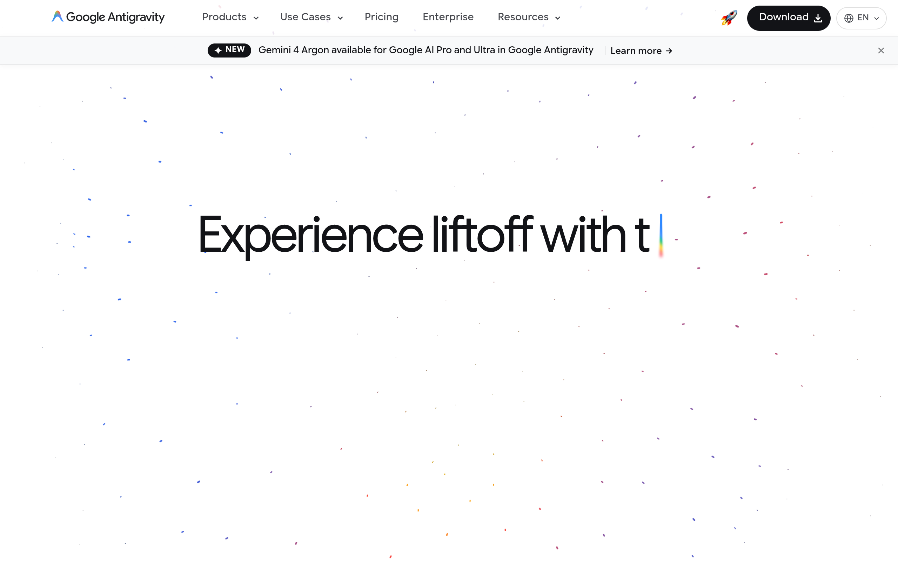

# antigravity Design System

You are building UI for **antigravity**. Light-themed, neutral palette, sans-serif typography (Google Sans Code), compact density on a 4px grid.

## Visual Reference

**IMPORTANT**: Study ALL screenshots below before writing any UI. Match colors, typography, spacing, layout, and motion exactly as shown.

### Homepage



> Read `references/DESIGN.md` for full token details.

## Design Philosophy

- **Layered depth** — use shadow tokens to create a sense of physical layering. Each elevation level has a specific shadow.
- **Gradient accents** — gradients are used thoughtfully for emphasis, not decoration.
- **Type pairing** — Google Sans Code for body/UI text, Google Sans Flex for headings/display. Never introduce a third typeface.
- **compact density** — 4px base grid. Every dimension is a multiple of 4.
- **neutral palette** — the color temperature runs neutral, matching the sans-serif typography.
- **Subtle motion** — transitions smooth state changes. Keep durations under 300ms, use ease-out curves.

## Color System

### Core Palette

| Role | Token | Hex | Use |
|------|-------|-----|-----|
| Background | `--background` | `#f8f9fa` | Page/app background |
| Surface | `--surface` | `#121317` | Cards, panels, modals |
| Text Primary | `--text-primary` | `#000000` | Headings, body text |
| Text Muted | `--text-muted` | `#5f6368` | Captions, placeholders |
| Border | `--border` | `#3c4043` | Dividers, card borders |

### Status Colors

| Status | Hex | Use |
|--------|-----|-----|
| Warning | `#3c2000` | Caution states, pending items |
| Danger | `#410e0b` | Errors, destructive actions |

### Extended Palette

- `#1a73e8`
- `#e8eaed` — Light surface or highlight color
- `#1557b0`
- `#8ab4f8`
- `#feefc3` — Light surface or highlight color
- `#fad2cf` — Light surface or highlight color
- `#fdd663`
- `#f28b82`

### CSS Variable Tokens

```css
--theme-primary-primary: var(--theme-surface-on-surface);
--theme-primary-on-primary: var(--theme-surface-surface);
--theme-button-states-primary-enabled: var(--theme-primary-primary);
--theme-button-states-primary-disabled: var(--palette-grey-10);
--theme-button-states-primary-hovered: var(--palette-grey-900);
--theme-button-states-primary-pressed: rgba(var(--palette-grey-50-rgb),.12);
--theme-button-states-primary-focused: rgba(var(--palette-grey-50-rgb),.2);
--theme-button-states-primary-on-disabled: rgba(var(--palette-grey-1000-rgb),.2);
--theme-secondary-button: rgba(var(--palette-grey-400-rgb),.1);
--theme-button-secondary-hover: var(--palette-grey-15);
--theme-button-secondary-inverse-hover: rgba(var(--palette-grey-600-rgb),.3);
--theme-primary-primary: var(--theme-surface-on-surface);
--theme-primary-on-primary: var(--theme-surface-surface);
--theme-button-states-primary-enabled: var(--theme-primary-primary);
--theme-button-states-primary-disabled: var(--palette-grey-10);
--theme-button-states-primary-hovered: var(--palette-grey-900);
--theme-button-states-primary-pressed: rgba(var(--palette-grey-50-rgb),.12);
--theme-button-states-primary-focused: rgba(var(--palette-grey-50-rgb),.2);
--theme-button-states-primary-on-disabled: rgba(var(--palette-grey-1000-rgb),.2);
--theme-secondary-button: rgba(var(--palette-grey-400-rgb),.1);
```

## Typography

### Font Stack

- **Google Sans Code** — Heading 1, Heading 2, Heading 3
- **Google Sans Flex** — Body, Caption
- **Courier New** — Code

### Font Sources

```css
@font-face {
  font-family: "Google Sans Flex";
  src: url("fonts/GoogleSansFlex-Bold.ttf") format("truetype");
  font-weight: 700;
}
@font-face {
  font-family: "Google Sans Flex";
  src: url("fonts/GoogleSansFlex-Regular.ttf") format("truetype");
  font-weight: 400;
}
@font-face {
  font-family: "Google Symbols";
  src: url("fonts/GoogleSymbols-Regular.ttf") format("truetype");
  font-weight: 400;
}
@font-face {
  font-family: "Google Symbols";
  src: url("fonts/GoogleSymbols-700.ttf") format("truetype");
  font-weight: 700;
}
@font-face {
  font-family: "Google Sans Code";
  src: url("fonts/GoogleSansCode-Bold.ttf") format("truetype");
  font-weight: 700;
}
@font-face {
  font-family: "Google Sans Code";
  src: url("fonts/GoogleSansCode-Regular.ttf") format("truetype");
  font-weight: 400;
}
@font-face {
  font-family: "Google Sans Text";
  src: url("fonts/GoogleSansText-Regular.ttf") format("truetype");
  font-weight: 400;
}
@font-face {
  font-family: "Google Sans Text";
  src: url("fonts/GoogleSansText-700.ttf") format("truetype");
  font-weight: 700;
}
@font-face {
  font-family: "Google Sans";
  src: url("fonts/GoogleSans-Bold.ttf") format("truetype");
  font-weight: 700;
}
@font-face {
  font-family: "Google Sans";
  src: url("fonts/GoogleSans-Regular.ttf") format("truetype");
  font-weight: 400;
}
```

### Type Scale

| Role | Family | Size | Weight |
|------|--------|------|--------|
| Heading 1 | Google Sans Code | 5rem | 700 |
| Heading 2 | Google Sans Code | 3.5rem | 700 |
| Heading 3 | Google Sans Code | 3rem | 700 |
| Body | Google Sans Flex | 13px | 400 |
| Caption | Google Sans Flex | .95rem | 400 |
| Code | Courier New | 14px | 400 |

### Typography Rules

- Body/UI: **Google Sans Code**, Headings: **Google Sans Flex** — these are the only display fonts
- Max 3-4 font sizes per screen
- Headings: weight 600-700, body: weight 400
- Use color and opacity for text hierarchy, not additional font sizes
- Line height: 1.5 for body, 1.2 for headings

## Spacing & Layout

### Base Grid: 4px

Every dimension (margin, padding, gap, width, height) must be a multiple of **4px**.

### Spacing Scale

`2, 4, 6, 8, 10, 12, 14, 16, 18, 20, 22, 24` px

### Spacing as Meaning

| Spacing | Use |
|---------|-----|
| 4-8px | Tight: related items (icon + label, avatar + name) |
| 12-16px | Medium: between groups within a section |
| 24-32px | Wide: between distinct sections |
| 48px+ | Vast: major page section breaks |

### Border Radius

Scale: `2px, 4px, 6px, 8px, 9px, 10px, 12px, 14px, 16px, 20px, 24px, 28px, 45px, 48px, 99em, 100px, 999px, inherit`
Default: `20px`

### Container

Max-width: `980px`, centered with auto margins.

### Breakpoints

| Name | Value |
|------|-------|
| xs | 319px |
| xs | 350px |
| xs | 480px |
| sm | 600px |
| sm | 640px |
| lg | 1024px |

Mobile-first: design for small screens, layer on responsive overrides.

## Component Patterns

### Card

```css
.card {
  background: #121317;
  border: 1px solid #3c4043;
  border-radius: 20px;
  padding: 16px;
  box-shadow: 0 1px 3px #1a73e826;
}
```

```html
<div class="card">
  <h3>Card Title</h3>
  <p>Card content goes here.</p>
</div>
```

### Button

```css
/* Primary */
.btn-primary {
  background: #cccccc;
  color: #000000;
  border-radius: 20px;
  padding: 8px 16px;
  font-weight: 500;
  transition: opacity 150ms ease;
}
.btn-primary:hover { opacity: 0.9; }

/* Ghost */
.btn-ghost {
  background: transparent;
  border: 1px solid #3c4043;
  color: #000000;
  border-radius: 20px;
  padding: 8px 16px;
}
```

```html
<button class="btn-primary">Get Started</button>
<button class="btn-ghost">Learn More</button>
```

### Input

```css
.input {
  background: #f8f9fa;
  border: 1px solid #3c4043;
  border-radius: 20px;
  padding: 8px 12px;
  color: #000000;
  font-size: 14px;
}
.input:focus { border-color: var(--accent); outline: none; }
```

```html
<input class="input" type="text" placeholder="Search..." />
```

### Badge / Chip

```css
.badge {
  display: inline-flex;
  align-items: center;
  padding: 4px 8px;
  border-radius: 9999px;
  font-size: 12px;
  font-weight: 500;
  background: #121317;
  color: #5f6368;
}
```

```html
<span class="badge">New</span>
<span class="badge">Beta</span>
```

### Modal / Dialog

```css
.modal-backdrop { background: rgba(0, 0, 0, 0.6); }
.modal {
  background: #121317;
  border: 1px solid #3c4043;
  border-radius: inherit;
  padding: 24px;
  max-width: 480px;
  width: 90vw;
  box-shadow: 0 4px 12px #0000000d;
}
```

```html
<div class="modal-backdrop">
  <div class="modal">
    <h2>Dialog Title</h2>
    <p>Dialog content.</p>
    <button class="btn-primary">Confirm</button>
    <button class="btn-ghost">Cancel</button>
  </div>
</div>
```

### Table

```css
.table { width: 100%; border-collapse: collapse; }
.table th {
  text-align: left;
  padding: 8px 12px;
  font-weight: 500;
  font-size: 12px;
  color: #5f6368;
  text-transform: uppercase;
  letter-spacing: 0.05em;
  border-bottom: 1px solid #3c4043;
}
.table td {
  padding: 12px;
  border-bottom: 1px solid #3c4043;
}
```

```html
<table class="table">
  <thead><tr><th>Name</th><th>Status</th><th>Date</th></tr></thead>
  <tbody>
    <tr><td>Item One</td><td>Active</td><td>Jan 1</td></tr>
    <tr><td>Item Two</td><td>Pending</td><td>Jan 2</td></tr>
  </tbody>
</table>
```

### Navigation

```css
.nav {
  display: flex;
  align-items: center;
  gap: 8px;
  padding: 12px 16px;
  border-bottom: 1px solid #3c4043;
}
.nav-link {
  color: #5f6368;
  padding: 8px 12px;
  border-radius: 20px;
  transition: color 150ms;
}
.nav-link:hover { color: #000000; }
```

```html
<nav class="nav">
  <a href="/" class="nav-link active">Home</a>
  <a href="/about" class="nav-link">About</a>
  <a href="/pricing" class="nav-link">Pricing</a>
  <button class="btn-primary" style="margin-left: auto">Get Started</button>
</nav>
```

### Extracted Components

These components were found in the codebase:

**Button** (`html`)

**Card** (`html`)
- Variants: `actions`, `-default`, `header`, `content`, `icon`

**Navigation** (`html`)

**Badge** (`html`)

**Modal** (`html`)

**List** (`html`)

## Page Structure

The following page sections were detected:

- **Navigation** — Top navigation bar (2 items)
- **Hero** — Hero/banner section with headline and CTAs
- **Features** — Feature/benefit cards grid (3 items)
- **Footer** — Page footer with links and info (21 items)
- **Cta** — Call-to-action section
- **Faq** — FAQ/accordion section
- **Testimonials** — Testimonials/reviews section

When building pages, follow this section order and structure.

## Animation & Motion

This project uses **subtle motion**. Transitions smooth state changes without calling attention.

### CSS Animations

- `delayed-fade-in`
- `blink`
- `apd-ring-fade-in`

### Motion Tokens

- **Duration scale:** `120ms`, `150ms`, `160ms`, `180ms`, `200ms`, `250ms`, `300ms`, `350ms`, `400ms`, `500ms`
- **Easing functions:** `ease-in-out`, `ease-out`, `cubic-bezier(.165,.84,.44,1)`, `cubic-bezier(.22,1,.36,1)`
- **Animated properties:** `opacity`

### Motion Guidelines

- **Duration:** Use values from the duration scale above. Short (120ms) for micro-interactions, long (500ms) for page transitions
- **Easing:** Use `ease-in-out` as the default easing curve
- **Direction:** Elements enter from bottom/right, exit to top/left
- **Reduced motion:** Always respect `prefers-reduced-motion` — disable animations when set

## Depth & Elevation

### Shadow Tokens

- Subtle: `0 0 0 2px #1a73e833`
- Subtle: `0 0 0 1px #f1f3f4`
- Subtle: `0 0 0 2px #1a73e8`
- Subtle: `0 0 0 2px #185abc`
- Subtle: `0 1px 0 rgba(0,0,0,.15)`
- Subtle: `inset 0 2px 0 rgba(0,0,0,.15)`

### Z-Index Scale

`0, 1, 2, 3, 4, 5, 10, 30, 90, 99, 100, 102, 986, 990, 991, 999, 1000, 1001, 1002, 1200, 9999, 10000, 99999, 100000`

Use these exact values — never invent z-index values.

## Anti-Patterns (Never Do)

- **No blur effects** — no backdrop-blur, no filter: blur()
- **No zebra striping** — tables and lists use borders for separation
- **No invented colors** — every hex value must come from the palette above
- **No arbitrary spacing** — every dimension is a multiple of 4px
- **No extra fonts** — only Google Sans Code and Google Sans Flex and Courier New are allowed
- **No arbitrary border-radius** — use the scale: 2px, 4px, 6px, 8px, 9px, 10px, 12px, 14px, 16px, 20px
- **No opacity for disabled states** — use muted colors instead

## Workflow

1. **Read** `references/DESIGN.md` before writing any UI code
2. **Pick colors** from the Color System section — never invent new ones
3. **Set typography** — Google Sans Code, Google Sans Flex, Courier New only, using the type scale
4. **Build layout** on the 4px grid — check every margin, padding, gap
5. **Match components** to patterns above before creating new ones
6. **Apply elevation** — use shadow tokens
7. **Validate** — every value traces back to a design token. No magic numbers.

## Brand Spec

- **Favicon:** `/favicon.svg`
- **Site URL:** `https://antigravity.google/`
- **Brand typeface:** Google Sans Code

## Quick Reference

```
Background:     #f8f9fa
Surface:        #121317
Text:           #000000 / #5f6368
Accent:         (not extracted)
Border:         #3c4043
Font:           Google Sans Code
Spacing:        4px grid
Radius:         20px
Components:     11 detected
```

## When to Trigger

Activate this skill when:
- Creating new components, pages, or visual elements for antigravity
- Writing CSS, Tailwind classes, styled-components, or inline styles
- Building page layouts, templates, or responsive designs
- Reviewing UI code for design consistency
- The user mentions "antigravity" design, style, UI, or theme
- Generating mockups, wireframes, or visual prototypes

---

# Full Reference Files

> Every output file is embedded below. Claude has full design system context from /skills alone.

## Design System Tokens (DESIGN.md)

# antigravity DESIGN.md

> Auto-generated design system — reverse-engineered via static analysis by skillui.
> Frameworks: None detected
> Colors: 20 · Fonts: 3 · Components: 11
> Icon library: not detected · State: not detected
> Primary theme: light · Dark mode toggle: no · Motion: subtle

## Visual Reference

**Match this design exactly** — study colors, fonts, spacing, and component shapes before writing any UI code.


---

## 1. Visual Theme & Atmosphere

This is a **light-themed** interface with a neutral, approachable feel. The light background emphasizes content clarity. Typography pairs **Google Sans Flex** for display/headings with **Google Sans Code** for body text, creating clear visual hierarchy through type contrast. Spacing follows a **4px base grid** (compact density), with scale: 2, 4, 6, 8, 10, 12, 14, 16px. Motion is subtle — smooth transitions (150-300ms) ease state changes without drawing attention.

---

## 2. Color Palette & Roles

| Token | Hex | Role | Use |
|---|---|---|---|
| light-bg | `#f8f9fa` | background | Page background, darkest surface |
| light-bg | `#202124` | background | Page background, darkest surface |
| card-bg-start | `#121317` | surface | Card and panel backgrounds |
| card-bg-end | `#0f1b33` | surface | Card and panel backgrounds |
| text-primary | `#000000` | text-primary | Headings and body text |
| text-muted | `#5f6368` | text-muted | Captions, placeholders, secondary info |
| border | `#3c4043` | border | Dividers, card borders, outlines |
| danger | `#410e0b` | danger | Error states, destructive actions |
| warning | `#3c2000` | warning | Warning states, caution indicators |
| info | `#1a73e8` | info | Informational highlights |
| unknown | `#e8eaed` | unknown | Palette color |
| unknown | `#1557b0` | unknown | Palette color |
| unknown | `#8ab4f8` | unknown | Palette color |
| unknown | `#feefc3` | unknown | Palette color |
| unknown | `#fad2cf` | unknown | Palette color |
| unknown | `#fdd663` | unknown | Palette color |
| unknown | `#f28b82` | unknown | Palette color |
| unknown | `#2d2e31` | unknown | Palette color |
| unknown | `#45474d` | unknown | Palette color |
| unknown | `#bdc1c6` | unknown | Palette color |

### CSS Variable Tokens

```css
--theme-primary-primary: var(--theme-surface-on-surface);
--theme-primary-on-primary: var(--theme-surface-surface);
--theme-button-states-primary-enabled: var(--theme-primary-primary);
--theme-button-states-primary-disabled: var(--palette-grey-10);
--theme-button-states-primary-hovered: var(--palette-grey-900);
--theme-button-states-primary-pressed: rgba(var(--palette-grey-50-rgb),.12);
--theme-button-states-primary-focused: rgba(var(--palette-grey-50-rgb),.2);
--theme-button-states-primary-on-disabled: rgba(var(--palette-grey-1000-rgb),.2);
--theme-secondary-button: rgba(var(--palette-grey-400-rgb),.1);
--theme-button-secondary-hover: var(--palette-grey-15);
--theme-button-secondary-inverse-hover: rgba(var(--palette-grey-600-rgb),.3);
--theme-primary-primary: var(--theme-surface-on-surface);
--theme-primary-on-primary: var(--theme-surface-surface);
--theme-button-states-primary-enabled: var(--theme-primary-primary);
--theme-button-states-primary-disabled: var(--palette-grey-10);
--theme-button-states-primary-hovered: var(--palette-grey-900);
--theme-button-states-primary-pressed: rgba(var(--palette-grey-50-rgb),.12);
--theme-button-states-primary-focused: rgba(var(--palette-grey-50-rgb),.2);
--theme-button-states-primary-on-disabled: rgba(var(--palette-grey-1000-rgb),.2);
--theme-secondary-button: rgba(var(--palette-grey-400-rgb),.1);
```


---

## 3. Typography Rules

**Font Stack:**
- **Google Sans Code** — Heading 1, Heading 2, Heading 3
- **Google Sans Flex** — Body, Caption
- **Courier New** — Code

**Font Sources:**

```css
@font-face {
  font-family: "Google Sans Flex";
  src: url("fonts/GoogleSansFlex-Bold.ttf") format("truetype");
  font-weight: 700;
}
@font-face {
  font-family: "Google Sans Flex";
  src: url("fonts/GoogleSansFlex-Regular.ttf") format("truetype");
  font-weight: 400;
}
@font-face {
  font-family: "Google Symbols";
  src: url("fonts/GoogleSymbols-Regular.ttf") format("truetype");
  font-weight: 400;
}
@font-face {
  font-family: "Google Symbols";
  src: url("fonts/GoogleSymbols-700.ttf") format("truetype");
  font-weight: 700;
}
@font-face {
  font-family: "Google Sans Code";
  src: url("fonts/GoogleSansCode-Bold.ttf") format("truetype");
  font-weight: 700;
}
@font-face {
  font-family: "Google Sans Code";
  src: url("fonts/GoogleSansCode-Regular.ttf") format("truetype");
  font-weight: 400;
}
@font-face {
  font-family: "Google Sans Text";
  src: url("fonts/GoogleSansText-Regular.ttf") format("truetype");
  font-weight: 400;
}
@font-face {
  font-family: "Google Sans Text";
  src: url("fonts/GoogleSansText-700.ttf") format("truetype");
  font-weight: 700;
}
@font-face {
  font-family: "Google Sans";
  src: url("fonts/GoogleSans-Bold.ttf") format("truetype");
  font-weight: 700;
}
@font-face {
  font-family: "Google Sans";
  src: url("fonts/GoogleSans-Regular.ttf") format("truetype");
  font-weight: 400;
}
```

| Role | Font | Size | Weight |
|---|---|---|---|
| Heading 1 | Google Sans Code | 5rem | 700 |
| Heading 2 | Google Sans Code | 3.5rem | 700 |
| Heading 3 | Google Sans Code | 3rem | 700 |
| Body | Google Sans Flex | 13px | 400 |
| Caption | Google Sans Flex | .95rem | 400 |
| Code | Courier New | 14px | 400 |

**Typographic Rules:**
- Limit to 3 font families max per screen
- Use **Google Sans Code** for body/UI text, **Google Sans Flex** for display/headings
- Maintain consistent hierarchy: no more than 3-4 font sizes per screen
- Headings use bold (600-700), body uses regular (400)
- Line height: 1.5 for body text, 1.2 for headings
- Use color and opacity for secondary hierarchy, not additional font sizes


---

## 4. Component Stylings

### Layout (1)

**Footer** — `html`

### Navigation (1)

**Navigation** — `html`

### Data Display (3)

**Card** — `html`
- Variants: `actions`, `-default`, `header`, `content`, `icon`

**Badge** — `html`

**List** — `html`

### Data Input (2)

**Button** — `html`
- Animation: 

**Input** — `html`
- State: :focus, :placeholder

### Overlay (1)

**Modal** — `html`

### Media (3)

**Image** — `html`

**Icon** — `html`

**Map/Canvas** — `html`


---

## 5. Layout Principles

- **Base spacing unit:** 4px
- **Spacing scale:** 2, 4, 6, 8, 10, 12, 14, 16, 18, 20, 22, 24
- **Border radius:** 2px, 4px, 6px, 8px, 9px, 10px, 12px, 14px, 16px, 20px, 24px, 28px, 45px, 48px, 99em, 100px, 999px, inherit
- **Max content width:** 980px

**Spacing as Meaning:**
| Spacing | Use |
|---|---|
| 4-8px | Tight: related items within a group |
| 12-16px | Medium: between groups |
| 24-32px | Wide: between sections |
| 48px+ | Vast: major section breaks |


---

## 6. Depth & Elevation

### Flat — subtle depth hints

- `0 0 0 2px #1a73e833`
- `0 0 0 1px #f1f3f4`
- `0 0 0 2px #1a73e8`

### Raised — cards, buttons, interactive elements

- `0 1px 3px #1a73e826`
- `0 2px 8px #1213170a`
- `0 2px 8px #00000047`

### Floating — dropdowns, popovers, modals

- `0 4px 12px #0000000d`
- `0 4px 12px #00000026`
- `0 2px 3px 0 rgba(60,64,67,.3),0 6px 10px 4px rgba(60,64,67,.15)`

### Overlay — full-screen overlays, top-level dialogs

- `0 16px 40px #0000001f,0 3px 10px #0000000a`
- `0 14px 36px -4px #00000024,0 4px 12px -2px #0000000f`
- `0 16px 40px #0000008c,0 4px 12px #00000059`

### Z-Index Scale

`0, 1, 2, 3, 4, 5, 10, 30, 90, 99, 100, 102, 986, 990, 991, 999, 1000, 1001, 1002, 1200, 9999, 10000, 99999, 100000`


---

## 7. Animation & Motion

This project uses **subtle motion**. Transitions smooth state changes without demanding attention.

### CSS Animations

- `@keyframes delayed-fade-in`
- `@keyframes blink`
- `@keyframes apd-ring-fade-in`

### Animated Components

- **Button**: 

### Motion Guidelines

- Duration: 150-300ms for micro-interactions, 300-500ms for page transitions
- Easing: `ease-out` for enters, `ease-in` for exits
- Always respect `prefers-reduced-motion`


---

## 8. Do's and Don'ts

### Do's

- Use `#f8f9fa` as the primary page background
- Pair **Google Sans Code** (body) with **Google Sans Flex** (display) — these are the only allowed fonts
- Follow the **4px** spacing grid for all margins, padding, and gaps
- Use the defined shadow tokens for elevation — see Section 6
- Use border-radius from the scale: 2px, 4px, 6px, 8px, 9px
- Reuse existing components from Section 4 before creating new ones

### Don'ts

- Don't introduce colors outside this palette — extend the design tokens first
- Don't introduce additional font families beyond Google Sans Code and Google Sans Flex and Courier New
- Don't use arbitrary spacing values — stick to multiples of 4px
- Don't create custom box-shadow values outside the system tokens
- Don't use arbitrary border-radius values — pick from the defined scale
- Don't duplicate component patterns — check Section 4 first
- Don't use backdrop-blur or blur effects

### Anti-Patterns (detected from codebase)

- No blur or backdrop-blur effects
- No zebra striping on tables/lists


---

## 9. Responsive Behavior

| Name | Value | Source |
|---|---|---|
| xs | 319px | css |
| xs | 350px | css |
| xs | 480px | css |
| sm | 600px | css |
| sm | 640px | css |
| lg | 1024px | css |

**Approach:** Use `@media (min-width: ...)` queries matching the breakpoints above.


---

## 10. Agent Prompt Guide

Use these as starting points when building new UI:

### Build a Card

```
Background: #121317
Border: 1px solid #3c4043
Radius: 20px
Padding: 16px
Font: Google Sans Code
Use shadow tokens from Section 6.
```

### Build a Button

```
Primary: bg var(--accent), text white
Ghost: bg transparent, border #3c4043
Padding: 8px 16px
Radius: 20px
Hover: opacity 0.9 or lighter shade
Focus: ring with var(--accent)
```

### Build a Page Layout

```
Background: #f8f9fa
Max-width: 980px, centered
Grid: 4px base
Responsive: mobile-first, breakpoints from Section 9
```

### Build a Stats Card

```
Surface: #121317
Label: #5f6368 (muted, 12px, uppercase)
Value: #000000 (primary, 24-32px, bold)
Status: use success/warning/danger from Section 2
```

### Build a Form

```
Input bg: #f8f9fa
Input border: 1px solid #3c4043
Focus: border-color var(--accent)
Label: #5f6368 12px
Spacing: 16px between fields
Radius: 20px
```

### General Component

```
1. Read DESIGN.md Sections 2-6 for tokens
2. Colors: only from palette
3. Font: Google Sans Code, type scale from Section 3
4. Spacing: 4px grid
5. Components: match patterns from Section 4
6. Elevation: shadow tokens
```

## Bundled Fonts (fonts/)

The following font files are bundled in the `fonts/` directory:

- `fonts/GoogleSans-Bold.ttf`
- `fonts/GoogleSans-Medium.ttf`
- `fonts/GoogleSans-Regular.ttf`
- `fonts/GoogleSans-SemiBold.ttf`
- `fonts/GoogleSansCode-Bold.ttf`
- `fonts/GoogleSansCode-ExtraBold.ttf`
- `fonts/GoogleSansCode-Light.ttf`
- `fonts/GoogleSansCode-Medium.ttf`
- `fonts/GoogleSansCode-Regular.ttf`
- `fonts/GoogleSansCode-SemiBold.ttf`
- `fonts/GoogleSansFlex-Black.ttf`
- `fonts/GoogleSansFlex-Bold.ttf`
- `fonts/GoogleSansFlex-ExtraBold.ttf`
- `fonts/GoogleSansFlex-ExtraLight.ttf`
- `fonts/GoogleSansFlex-Light.ttf`
- `fonts/GoogleSansFlex-Medium.ttf`
- `fonts/GoogleSansFlex-Regular.ttf`
- `fonts/GoogleSansFlex-SemiBold.ttf`
- `fonts/GoogleSansFlex-Thin.ttf`
- `fonts/GoogleSansText-500.ttf`
- `fonts/GoogleSansText-700.ttf`
- `fonts/GoogleSansText-Regular.ttf`
- `fonts/GoogleSymbols-100.ttf`
- `fonts/GoogleSymbols-200.ttf`
- `fonts/GoogleSymbols-300.ttf`
- `fonts/GoogleSymbols-500.ttf`
- `fonts/GoogleSymbols-600.ttf`
- `fonts/GoogleSymbols-700.ttf`
- `fonts/GoogleSymbols-Regular.ttf`

Use these local font files in `@font-face` declarations instead of fetching from Google Fonts.

## Homepage Screenshots (screenshots/)


